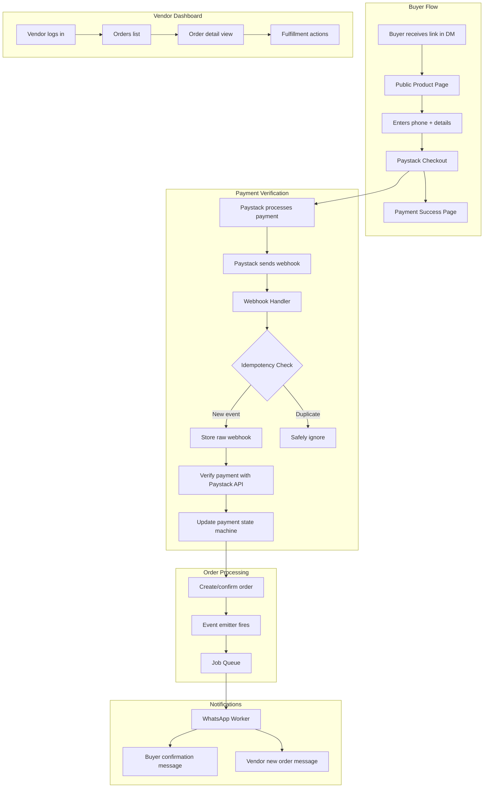
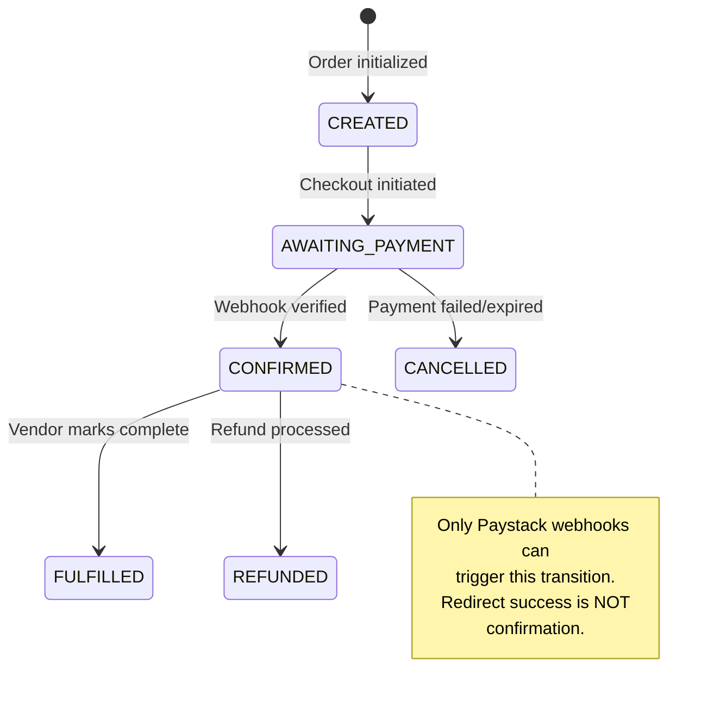
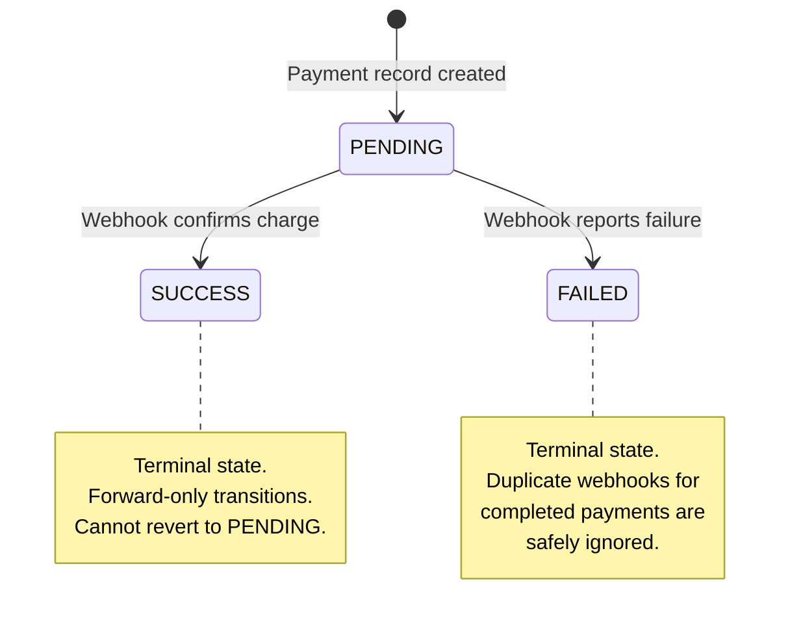
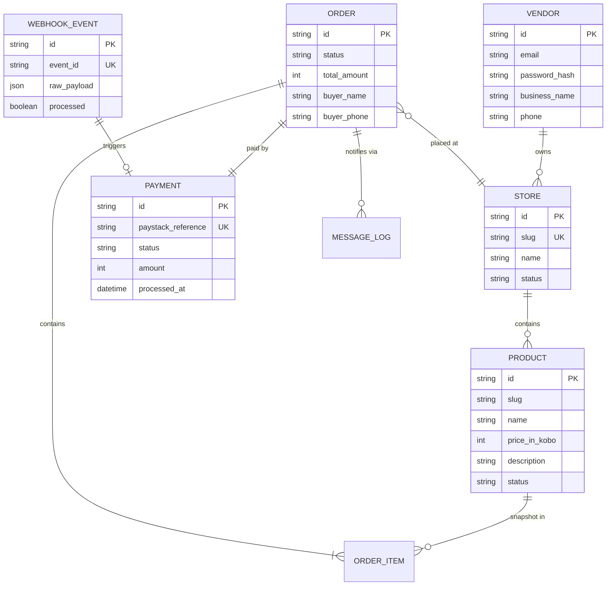

# Tanna — System Architecture

## Overview

Tanna is a monorepo containing a React frontend and a Node.js/Fastify backend. The system is designed around a single principle: **payment state must be indisputable**.

Every architectural decision flows from this. Webhooks are the source of truth. State transitions are forward-only. Notifications are event-driven.

---

## System Architecture

---

## Data Flow: Payment Lifecycle

---

## Payment State Machine

---

## Core Components

### Backend (`/backend/src`)

| Component | Purpose |
|---|---|
| `routes/webhooks.ts` | Receives Paystack webhooks, validates signature, triggers processing |
| `routes/public.routes.ts` | Public product pages and checkout initiation (no auth required) |
| `routes/orders.ts` | Vendor order management (authenticated) |
| `routes/products.ts` | Product CRUD for vendors |
| `routes/auth.ts` | Vendor registration and login |
| `services/payment.service.ts` | Payment state machine and verification logic |
| `services/order.service.ts` | Order creation with product snapshots |
| `services/whatsapp.service.ts` | WhatsApp Business API integration |
| `services/notification.handler.ts` | Event-driven notification dispatch |
| `lib/idempotency.ts` | Webhook deduplication and forward-only state enforcement |
| `lib/queue.ts` | Postgres-backed durable job queue |
| `lib/events.ts` | Internal event emitter for decoupled processing |
| `worker.ts` | Background job processor (WhatsApp delivery, webhook processing) |

### Frontend (`/frontend/src`)

| Component | Purpose |
|---|---|
| `pages/public/PublicProductPage.tsx` | Buyer-facing product page (mobile-optimized) |
| `pages/PaymentVerify.tsx` | Post-payment confirmation screen |
| `pages/vendor/VendorDashboard.tsx` | Order overview for vendors |
| `pages/vendor/ProductListPage.tsx` | Product management |
| `pages/auth/LoginPage.tsx` | Vendor authentication |
| `components/public/BuyerInfoForm.tsx` | Checkout form (name, phone, quantity) |
| `context/AuthContext.tsx` | JWT-based auth state management |

---

## Database Schema

---

## Key Architectural Decisions

### 1. Webhook-First Payment Verification
**Decision**: Only Paystack webhooks mutate payment/order state. Client-side redirect success is ignored.  
**Rationale**: Redirect-based confirmation is unreliable (browser closes, network drops). Webhooks are server-to-server and retried by Paystack.

### 2. Postgres-Backed Job Queue
**Decision**: Use PostgreSQL for job queuing instead of Redis/RabbitMQ.  
**Rationale**: One fewer infrastructure dependency. Transactional consistency with order data. Sufficient throughput for MVP scale.

### 3. Product Snapshots in Orders
**Decision**: Order items store a snapshot of the product at purchase time, not a foreign key reference.  
**Rationale**: Vendors change prices. A buyer who paid ₦5,000 should see ₦5,000 on their receipt, even if the vendor later changes the price to ₦7,000.

### 4. Forward-Only State Machines
**Decision**: Payment state (PENDING → SUCCESS/FAILED) and order state (CREATED → AWAITING_PAYMENT → CONFIRMED) can only move forward.  
**Rationale**: Prevents accidental state regression. Makes idempotency trivial — if state has already advanced, skip the event.

### 5. WhatsApp Template-Only Messages
**Decision**: All WhatsApp messages use pre-approved Meta templates. No free-text messaging.  
**Rationale**: Meta requires template approval for business-initiated messages. Templates also enforce message discipline — no marketing spam, just transaction facts.

---

## Infrastructure (Staging)

- **Compute**: AWS EC2 (t3.micro) with PM2 process manager
- **Database**: PostgreSQL 15 on the same instance
- **Deployment**: Script-based (`deploy-ec2.ps1`) with server setup automation (`server-setup.sh`)
- **Process Management**: PM2 ecosystem config for app + worker processes
